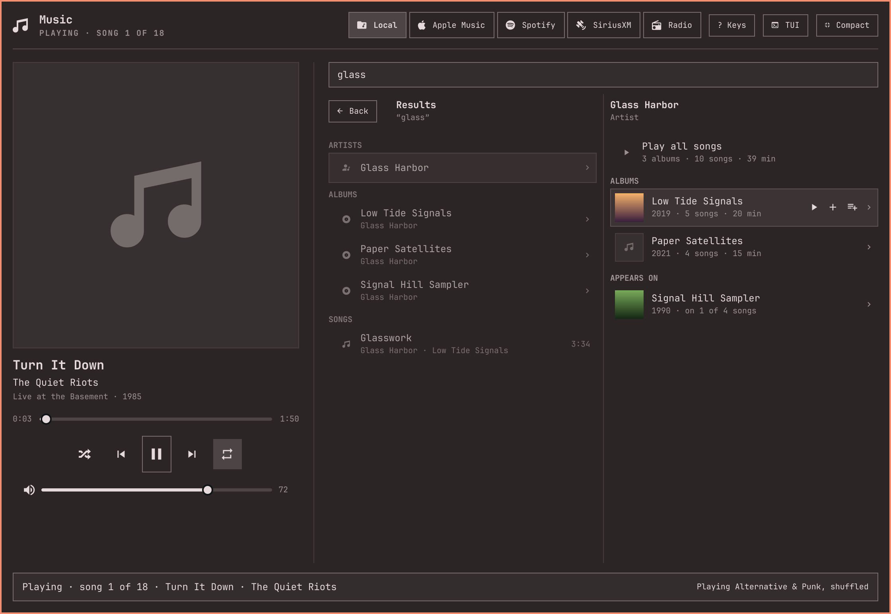
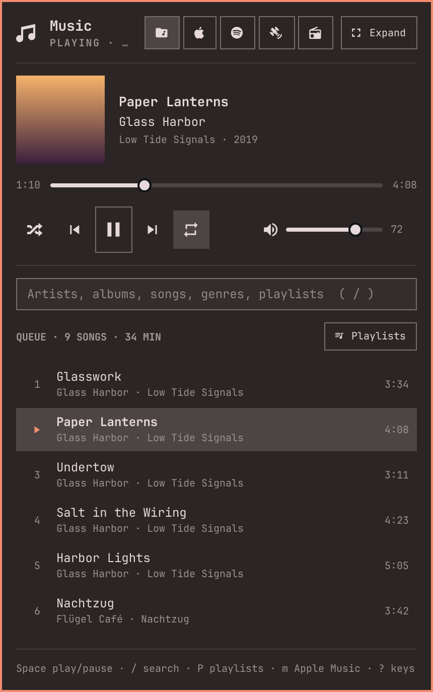

# omarock

**A music player that lives in your Omarchy bar.** omarock shows what's playing
(the cover, the artist and the song) in the bar. Click it for a keyboard-driven
player: search and browse your music library, build playlists, and switch to
internet radio, Spotify, Apple Music or SiriusXM in the same panel.

omarock is a client for [mpd](https://www.musicpd.org), the Music Player Daemon.
Your queue, playlists and playback live in mpd, not in omarock, so `mpc`, your
media keys and any other mpd client always agree with it.

<!-- Placeholders from the test harness (a made-up library); real ones to come. -->


| In the bar | The compact panel |
| --- | --- |
|  |  |

## Features

- **In the bar:** the album cover and "Artist — Song". Click for the player;
  middle-click to play or pause.
- **Compact or expanded:** now playing, transport, volume and the queue.
  **Expand** turns the same popup into a two-column browser.
- **Search that forgives you:** artists, albums, songs, genres and playlists,
  ignoring case and accents ("husker" finds Hüsker Dü).
- **Browse like a file manager:** → opens an artist, then one of their albums;
  ← goes back. A genre opens to its artists. Album covers throughout.
- **From what's playing:** click the artist, the album or its cover, or the
  genre, to open them. **Add to library** and **Add to playlist** are right
  under the song.
- **Playlists as you go:** press **A** on any song, album, artist or genre to
  add it to a playlist (mpd's own stored playlists).
- **Everything about a song or album (`i`):** its tags, format, bitrate and
  size, and, on a streaming service, whether it's in your library.
- **Keys that do what you'd guess,** and the full list is a `?` away.
- **One volume for every source** (with omarock's optional audio bus).

## Music sources

Local music and internet radio need nothing beyond mpd. Spotify, Apple Music
and SiriusXM are add-ons: set up the service, then switch the source on in
omarock's settings (each has its own switch). Only then does it get a button
in the panel, and only then does omarock talk to its service. Internet radio
has a switch too, on until you turn it off.

| Source | What you need |
| --- | --- |
| **Local music** | mpd and your music folder. |
| **Internet radio** | Nothing more: stations come from [Radio Browser](https://www.radio-browser.info), a free community directory, and mpd plays them. Your favourites are an mpd playlist. |
| **Spotify** | Spotify Premium, your own (free) Spotify developer app, and the `omarock-spotify` service, which drives Spotify's own player, Soloist ([spotify/](spotify/README.md)). |
| **Apple Music** | An Apple Music subscription and a Mac running the omarock bridge ([bridge/](bridge/API.md)). The bridge is built with your own Apple Developer membership (for MusicKit), and the Mac must be reachable from your Omarchy machine (omarock uses Tailscale). Advanced. |
| **SiriusXM** | A SiriusXM subscription that includes streaming, and the `omarock-sxm` service ([sxm/](sxm/README.md)). It's unofficial: it signs in as SiriusXM's web player does, which their terms may not allow. |

## Requirements

- **Omarchy 4** (tested on 4.0.4). omarock is a plugin for its bar.
- **mpd 0.24 or later**, with a unix socket at `$XDG_RUNTIME_DIR/mpd/socket`
  (or set omarock's `socket` setting to yours). Quickshell, which runs Omarchy's
  bar, can only open unix sockets, not mpd's usual TCP port.
- **mpd-mpris**, for the media keys.
- **Album covers:** an image in each album folder, such as `cover.jpg`. Art embedded
  in the files isn't shown.
- **Optional:** `ncmpcpp`, the terminal player `t` opens (or set `tuiCommand`).

omarock is young. It's used every day on one Omarchy desktop.

## Install

The installer sets up your own music and the radio:

```bash
git clone https://github.com/marcewing/omarock
cd omarock
./install
```

It sets up mpd (asking where your music is), then puts omarock on the bar. It
checks first what's already there, shows each command before running it, and
asks before changing anything: packages (with sudo), your mpd config, systemd
units. Run it again any time: what's done is skipped.

**Spotify, SiriusXM and Apple Music** come afterwards, one at a time, from
omarock's settings (press `,` in the panel, or the gear in the expanded view).
Each has a **Set up…** button, which opens a terminal that walks you through it,
as Omarchy's own installs do. Passwords and keys go into hidden prompts, and
from there into files only you can read. Once it's set up, the source has a
switch (off stops its services and keeps your accounts and keys), its settings,
and **Remove…**, which takes it off again, accounts and keys included. From a
terminal it's the same: `./install spotify`, `./install siriusxm`,
`./install apple-music`, and `./install --remove spotify` and so on.

**Apple Music** also needs the bridge on a Mac: clone omarock there too and run
`./install` on the Mac first.

**omarock's sound output** (also in the settings, optional) sends everything
omarock plays into one output you pick, with one volume, and never anywhere
else. Most don't need it; it matters if some output must never carry music.

Keep the clone: the plugin and the services install from it. When the plugin
has a newer version of a service than the one running, its settings offer
**Update…**.

**Using Claude Code?** Open the clone in it and ask it to set omarock up. Its
`omarock-setup` skill knows the steps and the usual snags, and checks before it
changes anything.

To do it by hand instead, follow the three steps below.

### 1. mpd

```bash
sudo pacman -S mpd mpd-mpris mpc
```

Give mpd a config, `~/.config/mpd/mpd.conf`, with your music folder and places
for its database, playlists and state:

```
music_directory     "~/Music"
playlist_directory  "~/.local/share/mpd/playlists"
db_file             "~/.local/share/mpd/database"
state_file          "~/.local/state/mpd/state"
sticker_file        "~/.local/share/mpd/sticker.sql"
```

and make the folders: `mkdir -p ~/.local/share/mpd/playlists ~/.local/state/mpd`.
Without `playlist_directory`, mpd turns stored playlists off, and omarock's
playlists and radio favourites with them.

omarock talks to mpd over a unix socket, so mpd must listen on one. Either:
- **The easy way:** `systemctl --user enable --now mpd.socket`. The unit that comes
  with mpd opens `$XDG_RUNTIME_DIR/mpd/socket`, and TCP port 6600 too.
- **Socket only:** add `bind_to_address "/run/user/1000/mpd/socket"` to mpd.conf
  (your user id in place of 1000), with a drop-in that makes the folder:
  ```ini
  # ~/.config/systemd/user/mpd.service.d/runtime-dir.conf
  [Service]
  RuntimeDirectory=mpd
  ```
  Then `systemctl --user daemon-reload && systemctl --user enable --now mpd`.

mpd scans your music the first time it starts. After you add music later, run
`mpc update`.

**The media keys** go through mpd-mpris. It exits whenever mpd restarts, and its
unit doesn't bring it back, so give it a drop-in that does:

```ini
# ~/.config/systemd/user/mpd-mpris.service.d/follow-mpd.conf
[Unit]
PartOf=mpd.service

[Service]
Restart=always
RestartSec=3
```

Then `systemctl --user daemon-reload && systemctl --user enable --now mpd-mpris`.

**Album covers** come from an image in each album's folder, named `cover`,
`folder`, `front` or `album` (`cover.jpg`, say).

### 2. omarock

```bash
omarchy plugin add https://github.com/marcewing/omarock --enable
```

`--enable` puts it on the left of the bar (`omarchy plugin enable mre.omarock
--section center`, or `right`, for elsewhere). Click it, and press `?` for the keys.

### 3. More sources (optional)

Each has a Set up… button in omarock's settings (above), and a guide for doing it
by hand:

- **Spotify:** [spotify/README.md](spotify/README.md)
- **Apple Music:** [bridge/README.md](bridge/README.md)
- **SiriusXM:** [sxm/README.md](sxm/README.md)
- **omarock's sound output** (one volume, and one pinned output, for
  everything): [audio/README.md](audio/README.md)

### Updating, and removing

```bash
omarchy plugin update mre.omarock
omarchy restart shell        # the shell's own reload keeps running the old code
```

The services (Spotify's, SiriusXM's, the sound output) update from the plugin:
after an update, a source with a newer service waiting says so in the settings,
with **Update…**. From your clone, `git pull` and then `./install spotify` (and
so on) does the same.

**Remove…** in the settings, or `./install --remove spotify` (`siriusxm`,
`apple-music`, `sound`), takes one source off, with its accounts and keys.
`./install --uninstall` takes all of omarock off: the plugin, each service, the
patches and the sound output (mpd gets its old output back). Each shows what it
removes and asks first, and leaves mpd, your music and playlists alone.
`omarchy plugin remove mre.omarock` alone removes only the plugin; the services
stay until you remove them too.

## Using omarock

- **The bar:** the album cover and "Artist — Song" (up to 300 px: the
  `maxLabelWidth` setting). A click opens the panel; a middle click plays or
  pauses. With nothing queued it shows the music note, and a middle click on it
  plays a song picked at random from your library (so does Play in the panel).
- **The panel:** now playing, with the cover, a seek bar, transport (shuffle,
  previous, play/pause, next, repeat) and volume, then search and the queue.
  **Expand** (`e`) makes it a bigger, two-column view in the same popup. It
  closes when the pointer leaves it, after a moment (the `closeOnLeave` setting).
  Open it again and it's as you left it: the search, where you'd browsed to, the
  cursor, an info card or the playlist picker, and the keys where they were (a
  setting you were typing is dropped, not saved).
- **The queue:** click a song to play it; × or `x` removes it.
- **Search** finds genres, artists, albums, songs and playlists, ignoring case and
  accents ("husker" finds Hüsker Dü). A space also matches punctuation, so "ac dc"
  finds AC/DC. A compilation is one result, not one per artist on it.
- **Browse** from a result: →, Enter or a click opens a genre (Shuffle all songs,
  then its artists), an artist (their albums by year, then the compilations they
  appear on) or an album (its songs, by disc). ←, Esc or **Back** goes back. ▶ plays
  anything at once, replacing the queue; `a` or + adds it to the end. Enter on a
  song in an album plays the album from that song. In the expanded panel, the left
  column holds the results, and the right one previews what → would open.
- **What's playing:** click the artist's name to open the artist, the album
  line or the cover to open the album, on the song playing, or the genre to open
  it (`O`, `o` and `g` do the same). ← goes back to the queue. On Apple Music, a
  genre opens Apple's charts for it, when it's one of Apple's top genres.
  Under the song, **Add to playlist** opens the playlist picker for it, and on
  Apple Music and Spotify **Add to library** saves it to your library (`L`
  too). On Spotify, a second click takes it out again; Apple Music's API can
  only add, so taking it out is for the Music app.
- **Your library (`L`):** on Apple Music or Spotify, `L` adds the song, album
  or (Apple Music) playlist under the cursor to your library, or, with no
  cursor, the song playing. In the info card it adds what the card shows. A
  song added on Apple Music reaches the Mac's library through iCloud, and only
  comes down while the Music app is running on the Mac. Until then it doesn't
  show among your albums, though omarock counts it in at once.
- **An album's place in your library:** an Apple Music or Spotify album says,
  beside its name, **In your library**, **4 of 12 in your library** (with a ✓ by
  each song you have), or **Add to library**. A click adds the whole album; on
  Spotify, where saving an album is apart from liking its songs, a click on In
  your library takes the album out again.
- **Heard it on the radio?** On SiriusXM or the radio, click the song's title or
  the artist (or `o`, `O`) to look it up in Apple Music or Spotify (the
  `lookup` setting picks), while the station plays on. Enter plays it there and
  switches to it; `a` adds it to that service's queue, `A` to one of its
  playlists; Esc comes back to the station.
- **Playlists** are mpd's stored playlists, so `mpc` and other clients see them
  too. `A` adds the song, album, artist or genre under the cursor to one: pick a
  playlist, or type a new name. `P` lists them, with **Save the queue as a
  playlist** at the top. A playlist opens like an album; `x` removes a song, and
  `x` on a playlist deletes it, after asking.
- **Info (`i`):** everything omarock knows about the song, album, station or
  channel under the cursor (or what's playing). At the top: the service and, for
  Spotify and Apple Music, whether it's in your library. For a local song: its
  tags, format, average bitrate, size and path.
- **Keys** do what you'd guess: Space play/pause, `/` search, arrows to move,
  open and go back, Shift+←/→ to seek, `n`/`p`, `+`/`-`, `m` the next source, `,`
  settings, `t` a terminal player (ncmpcpp), `?` for the full list.
  - **The hint line** under the list shows the keys that work where you are: on
    the row under the cursor, or in the search box while you type. It never
    changes the panel's height. When there are too many for it, the least used
    are left out.
  - **The keys page (`?`)** starts with RIGHT NOW: all of those keys, in full.
    Its **Window** button (or `w`) keeps the keys open in a window of their own,
    beside the panel. Right now there follows the panel as you move, and Esc
    or `q` closes the window. Hyprland floats it, and you can resize it (on
    Omarchy, Super and a right-drag); it opens again at the size you left it.
- **From a key binding:** `qs ipc -p /usr/share/omarchy/shell call mre.omarock toggle`
  opens the panel.

### The other sources

- **Internet radio:** the station playing, your favourites, then the most
  listened stations in your US state (set it in the settings). `/` finds stations by name, call sign, frequency
  or genre; Enter tunes; `A` keeps a favourite (in the mpd playlist "Radio", so
  `mpc load Radio` plays them); `n`/`p` step through the favourites. Stations that
  send their song show it. HLS-only stations are dimmed: mpd can't play them.
- **Spotify:** search your library, then Spotify's catalog; browse artists,
  albums and playlists; its queue, **P** for your Spotify playlists, **A** to add
  to them. It plays on this machine, through Spotify's own player, and shows up
  in Spotify Connect under the machine's name: start something from your phone
  and omarock follows. One player at a time: switching to Spotify pauses mpd
  where it was, and mpd playing again takes over. Apps like this one get no
  genres from Spotify; other people's playlists play, but their songs aren't
  listed; and songs can't be taken out of Spotify's queue.
- **Apple Music:** search your library, then the catalog; browse artists,
  albums and genres; the Mac's queue, **P** for your playlists, **A** to add to
  them. An artist is one page, wherever you open it: their top songs, your
  albums, then the rest of the catalog's (albums, singles and EPs, appears on).
  An album you have only some songs of is in both lists, saying how many you have. The Mac plays the music, and its sound comes over the network as a
  stream that mpd plays, so `mpc` and the media keys follow it too. Once the Mac
  has been paused for a minute (`appleIdleStop`), mpd lets go of the stream, and
  Play reconnects.
- **SiriusXM:** your favourite channels, then all of them, each with its logo
  and what's on. Enter tunes, `n`/`p` step through the favourites, `A` adds or
  removes a favourite (your account's, as in the SiriusXM app). Space stops and
  starts: it's live.
- **On more than one machine:** local music, the radio and SiriusXM play on
  each machine on its own. Apple Music and Spotify play on one machine at a
  time, the one where you last pressed Play: a Spotify account plays on one
  device at a time, and the Mac has one Apple Music player. The other
  machines' panels show it paused, "Playing on dellxps · Play moves it here",
  and their pause and skip don't reach it. (Apple Music needs bridge 0.5.)

## Settings

Press `,` in the panel, or the gear in the expanded view, for the settings
screen. Everything is there: the sources (each says how its service is doing),
your music folder, each source's account and keys, and how the panel behaves.
A change saves at once.

- **Settings** are kept in `~/.config/omarock/settings.json`, which you can also
  edit by hand; omarock follows it as it changes:

  ```json
  { "spotify": true, "tuiCommand": "rmpc" }
  ```

  (Before 0.6 they were keys on omarock's entry in `~/.config/omarchy/shell.json`;
  those still apply until you change them.)
- **Accounts and keys** (the SiriusXM login, Spotify's Client ID and Soloist
  key, the bridge's token) each keep their own file in `~/.config/omarock`,
  readable only by you. The settings screen never shows a password or key: its
  field starts empty and says whether one is set. `tools/omarock-account` does
  the same from a terminal.
- **The music folder** is mpd's `music_directory`. Changing it asks first, then
  keeps a copy of mpd.conf, changes only that line, and restarts mpd.

| Setting | Default | What it does |
| --- | --- | --- |
| `radio` | on | Internet radio |
| `radioState` | none | Your US state, for the radio's local stations |
| `spotify` | off | Spotify ([spotify/README.md](spotify/README.md)) |
| `appleMusic` | off | Apple Music ([bridge/README.md](bridge/README.md)) |
| `siriusXM` | off | SiriusXM ([sxm/README.md](sxm/README.md)) |
| `lookup` | Apple Music | Where a click on the radio's song looks it up: `Apple Music` or `Spotify` (the other one if that one is off) |
| `socket` | `$XDG_RUNTIME_DIR/mpd/socket` | mpd's unix socket |
| `tuiCommand` | `ncmpcpp` | The terminal player `t` opens |
| `closeOnLeave` | on | Close the panel when the pointer leaves it |
| `maxLabelWidth` | 300 | How wide the song gets on the bar, in pixels |
| `appleBridge`, `appleStream` | from `~/.config/omarock/apple.json` | The Apple Music bridge's address, and its stream's |
| `appleTokenFile` | `~/.config/omarock/bridge-token` | The bridge's token |
| `appleIdleStop` | 60 | Seconds the Mac is paused before mpd lets go of its stream (0: never) |
| `appleRejoin` | on | Reconnect mpd to the Apple Music stream after each change; turn off with the patched libFLAC ([patches/README.md](patches/README.md)) |
| `spotifyService` | `http://127.0.0.1:8730` | omarock-spotify's address |
| `sxmService` | `http://127.0.0.1:8720` | omarock-sxm's address |
| `radioBrowser` | a Radio Browser server | A Radio Browser server to use |

## Troubleshooting

- **"Waiting for mpd…":** mpd isn't on the socket omarock looks at. Check `ls
  $XDG_RUNTIME_DIR/mpd/socket` and `systemctl --user status mpd`, or set `socket`.
- **No covers:** omarock reads `cover.jpg` (or `folder.png`, and the like) from each
  album's folder, through mpd. Folders without one show a note.
- **A change didn't show up after updating:** `omarchy restart shell`.
- **Anything else:** `journalctl --user -b | grep omarock`. The panel logs its
  version when it loads, and any mpd command or service request that was slow.

## Contributing

[DEVELOPING.md](DEVELOPING.md) has the layout, the tests and how omarock works
inside. omarock is under the MIT License ([LICENSE](LICENSE)).
