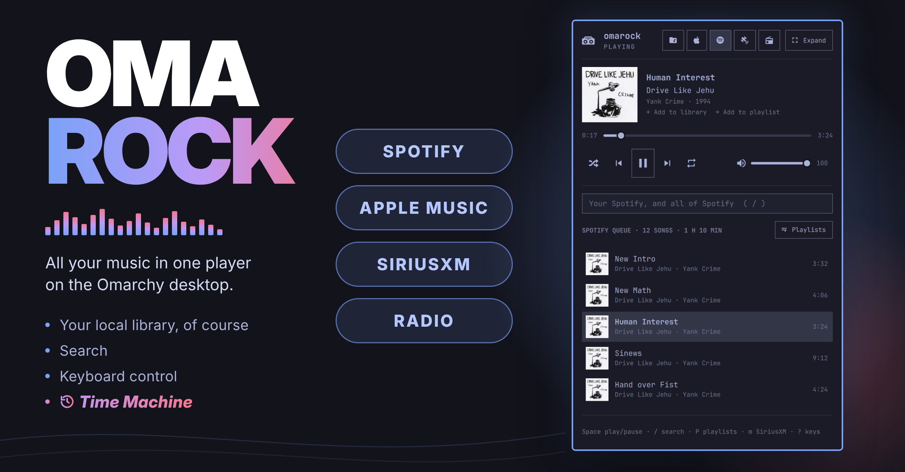

# omarock

**A music player that lives in your Omarchy bar.** omarock has all the usual music player
features: search, browse, build playlists, cover art, etc.  Unlike many music players,
in addition to your local music library, omarock can also play internet radio stations, **Spotify**,
**Apple Music**, and **SiriusXM** all integrated in the same panel.  Note that these last three
require paid subscriptions.

omarock works as a client for [mpd](https://www.musicpd.org), the Music Player Daemon.
The music queue, playlists and playback live in mpd, not in omarock, so `mpc`, your
media keys and any other mpd client are always in sync.

## Features

- **Keyboard or Mouse**: You can drive omarock either way. `Super+Ctrl+M` opens omarock. `?` shows all the keys used for navigation and control.
- **Compact or expanded:** Expanded view allows browsing in a two-column view.
- **Search that forgives:** Use `/` to search ignoring case and accents
  ("husker" finds Hüsker Dü).
- **Browse like a file manager:** `→` opens an artist, then one of their albums;
  `←` goes back. A genre opens to its artists. Album covers are displayed throughout.
- **Now Playing:** Click the artist, the album or its cover, or the
  genre, to open them.
- **Build Playlists:** `A` adds any song, album, artist or genre to
  a playlist (mpd's playlists).
- **Find Heard Songs:** Click the song or artist displayed on FM or SiriusXM to find that song on Spotify or Apple Music.
- **Song and Album Info:** `i` show tags, format, bitrate and
  size, and, on a streaming service, whether it's in your library.
- **Time Machine:** Enter a year to pretend you are listening in that year.  Only music released prior shows or
  plays, and there's a Billboard Top 100 from that year to play on Apple Music or Spotify. Fun.
- **History:** `H` shows you what you've played this past week, from every source,
  radio songs included.
- **One volume for every source:** With omarock's optional audio bus, all sources are routed through omarock's volume control.

## Music sources

Local music and internet radio need nothing beyond mpd. Spotify, Apple Music
and SiriusXM are add-ons: After installing omarock, set up each service in
omarock's settings (each has its own switch). Only enabled services get a button
in the panel. Internet radio
has a switch too if you don't want to see that either.

The table below shows the details, but don't worry, the setup process in settings will walk you through it all.

| Source | What you need |
| --- | --- |
| **Local music** | mpd and your music folder. |
| **Internet radio** | Nothing more: stations come from [Radio Browser](https://www.radio-browser.info), a free community directory, and mpd plays them. Your favourites are an mpd playlist. |
| **Spotify** | Spotify Premium, your own (free) Spotify developer app, Soloist (Spotify's own player) and the `omarock-spotify` service, which drives it ([spotify/README.md](spotify/README.md)). |
| **Apple Music** | An Apple Music subscription and a Mac running the `omarock-bridge`. The bridge is built with your own Apple Developer membership (for MusicKit), and the Mac must be reachable from your Omarchy machine (I use Tailscale). Advanced.  ([apple-bridge/README.md](apple-bridge/README.md))|
| **SiriusXM** | A SiriusXM subscription that includes streaming, and the `omarock-sxm` service. It's unofficial: it signs in as SiriusXM's web player does, which their terms may not allow.  ([sxm/README.md](sxm/README.md))|

## Requirements

- **Omarchy 4** (tested on 4.0.4). omarock is a plugin for its bar.
- **mpd 0.24 or later**, with a unix socket at `$XDG_RUNTIME_DIR/mpd/socket`
  (or set omarock's `socket` setting to yours). Quickshell, which runs Omarchy's
  bar, can only open unix sockets, not mpd's usual TCP port.
- **mpd-mpris**, for the media keys.
- **Album covers:** an image in each album folder, such as `cover.jpg`. Art embedded
  in the files isn't shown.

## Install

The installer sets up omarock with your own music and internet radio:

```bash
git clone https://github.com/marcewing/omarock
cd omarock
./install
```

The install sets up mpd (asking where your music is), and puts omarock on the bar.
It first checks what's already installed, shows each command before running it, and
asks before changing anything: packages (with sudo), your mpd config, systemd
drop-ins, and your key bindings. It starts mpd and mpd-mpris (the media keys) and
has them start at each login. Run it again any time.

**Spotify, SiriusXM and Apple Music** are set up from omarock's settings, one at a time.
Each has a **Set up…** button in their tab which will walk you through each step,
and the actual install and setup procedure executes in a terminal.
Once set up, each source has a
switch (off stops its services and keeps your accounts and keys), its settings,
and **Remove…**, which removes the source and configuration, accounts and keys included.

**Apple Music** also needs a bridge running on a Mac: clone omarock on your Mac and run
`./install` there first.

**omarock's sound output** (also in settings, optional but highly recommended) sends everything
omarock plays into one output you pick, with one volume, and never anywhere
else. Most don't need it; it matters if some output must never carry music.

If you keep your plugin up to date with `omarchy plugin update marcewing.omarock`,
when the plugin detects a newer version of a service than the one running, its
settings offer **Update…**, and its tab is marked •.


## Get Rocking

If you accepted the keybinding at install, `Super+Ctrl+M` will open up omarock and the rest I'm sure you can figure out.  If you like, you can read the entirely claude-generated **Using Omarock** and **Settings** sections below, but I doubt you need to.


## Install by hand (not recommended)


**Using Claude Code?** Run claude in the clone directory and ask it to set omarock up. Its
`omarock-setup` skill knows the steps and the usual snags, and checks before it
changes anything.

To install omarock by hand instead, follow the three steps below.

### 1. mpd

```bash
sudo pacman -S mpd mpd-mpris mpc
```

Give mpd a config, `~/.config/mpd/mpd.conf`, with your music folder and places
for its database, playlists and state:

```
music_directory     "~/Music"
playlist_directory  "~/.local/share/mpd/playlists"
db_file             "~/.local/share/mpd/database"
state_file          "~/.local/state/mpd/state"
sticker_file        "~/.local/share/mpd/sticker.sql"
restore_paused      "yes"
```

and make the folders: `mkdir -p ~/.local/share/mpd/playlists ~/.local/state/mpd`.
Without `playlist_directory`, mpd turns stored playlists off, and omarock's
playlists and radio favourites with them. `restore_paused` makes mpd start
paused, at login or after a crash, rather than playing on from its last saved
state, which can be minutes old.

omarock talks to mpd over a unix socket, so mpd must listen on one. Either:
- **The quick way:** `systemctl --user enable --now mpd.socket`. The unit that comes
  with mpd opens `$XDG_RUNTIME_DIR/mpd/socket`, and TCP port 6600 too, on every
  network interface: without a password in mpd.conf, anyone who can reach this
  machine (your LAN; your tailnet, which ufw doesn't cover) can play, stop and
  change mpd. `./install` does it the next way instead (with port 6600 on
  localhost only, for `mpc` and other clients).
- **Socket only:** add `bind_to_address "/run/user/1000/mpd/socket"` to mpd.conf
  (your user id in place of 1000), with a drop-in that makes the folder:
  ```ini
  # ~/.config/systemd/user/mpd.service.d/runtime-dir.conf
  [Service]
  RuntimeDirectory=mpd
  ```
  Then `systemctl --user daemon-reload && systemctl --user enable --now mpd`.

mpd scans your music the first time it starts. After you add music later, run
`mpc update`.

**After a crash,** mpd's own unit leaves it down. A drop-in brings it back
(paused, with `restore_paused`):

```ini
# ~/.config/systemd/user/mpd.service.d/restart.conf
[Service]
Restart=on-failure
RestartSec=2
```

Then `systemctl --user daemon-reload`.

**The media keys** go through mpd-mpris. It exits whenever mpd restarts, and its
unit doesn't bring it back, so give it a drop-in that does:

```ini
# ~/.config/systemd/user/mpd-mpris.service.d/follow-mpd.conf
[Unit]
PartOf=mpd.service

[Service]
Restart=always
RestartSec=3
```

Then `systemctl --user daemon-reload && systemctl --user enable --now mpd-mpris`.

**Album covers** come from an image in each album's folder, named `cover`,
`folder`, `front` or `album` (`cover.jpg`, say).

### 2. omarock

```bash
omarchy plugin add https://github.com/marcewing/omarock --enable
```

`--enable` puts it on the left of the bar (`omarchy plugin enable marcewing.omarock
--section center`, or `right`, for elsewhere). Click it, and press `?` for the keys.

A key to open it is a line in `~/.config/hypr/bindings.lua` (Omarchy's shell
opens the omarock on the screen you're using):

```lua
o.bind("SUPER + CTRL + M", "omarock", "omarchy-shell shell toggle marcewing.omarock")
```

### 3. More sources (optional)

Each has a Set up… button in omarock's settings (above), and a guide for doing it
by hand:

- **Spotify:** [spotify/README.md](spotify/README.md)
- **Apple Music:** [apple-bridge/README.md](apple-bridge/README.md)
- **SiriusXM:** [sxm/README.md](sxm/README.md)
- **omarock's sound output** (one volume, and one pinned output, for
  everything): [audio/README.md](audio/README.md)

### Updating, and removing

```bash
omarchy plugin update marcewing.omarock
omarchy restart shell        # the shell's own reload keeps running the old code
```

The services (Spotify's, SiriusXM's, the sound output) update from the plugin:
after an update, a source with a newer service waiting says so in the settings,
with **Update…**. From your clone, `git pull` and then `./install spotify` (and
so on) does the same.

**Remove…** in the settings, or `./install --remove spotify` (`siriusxm`,
`apple-music`, `sound`), takes one source off, with its accounts and keys.
`./install --uninstall` takes all of omarock off: its key, the plugin, each service, the
patches and the sound output (mpd gets its old output back). Each shows what it
removes and asks first, and leaves mpd, your music and playlists alone.
`omarchy plugin remove marcewing.omarock` alone removes only the plugin; the services
stay until you remove them too.

## Using omarock

- **The bar:** the album cover and "Artist — Song" (up to 300 px: the
  `maxLabelWidth` setting; longer, it ends in …, or scrolls with
  `scrollBarSong` on). A click opens the panel (so does Super+Ctrl+M, once
  `./install` has set it up); a middle click plays or pauses. With nothing queued it shows a boombox, and a middle click on it
  plays a song picked at random from your library (so does Play in the panel).
- **The panel:** now playing, with the cover (a song, artist or album too
  long for its line scrolls), a seek bar, transport (shuffle, previous,
  play/pause, next, repeat) and volume, then search and the queue.
  **Expand** (`e`) makes it a bigger, two-column view in the same popup. It
  closes 3 seconds after the pointer leaves it, unless it comes back (the `closeOnLeave` setting).
  Open it again and it's as you left it: the search, where you'd browsed to, the
  cursor, an info card or the playlist picker, and the keys where they were (a
  setting you were typing is dropped, not saved).
- **The queue:** click a song to play it; × or `x` removes it.
- **Search** finds genres, artists, albums, songs and playlists, ignoring case and
  accents ("husker" finds Hüsker Dü). A space also matches punctuation, so "ac dc"
  finds AC/DC. A compilation is one result, not one per artist on it.
- **Browse** from a result: →, Enter or a click opens a genre (its artists), an
  artist (their albums by year, then the compilations they appear on) or an album
  (its songs, by disc). ←, Esc or **Back** goes back. Under the heading, buttons
  act on all of it: **Play** (or Shuffle, for a genre) replaces the queue with it
  and plays; **Add to queue** adds it to the end; **Add to playlist** adds it to
  one of your playlists. ↑ from the first song puts the cursor on them, where
  Enter, `a` and `A` do the same. On a row, ▶ plays it at once, replacing the
  queue, and `a` or + adds it to the end. Enter on a song in an album or playlist
  plays it from that song. In the expanded panel, the left column holds the
  results, and the right one previews what → would open.
- **What's playing:** click the artist's name to open the artist, the album
  line or the cover to open the album, on the song playing, or the genre to open
  it (`O`, `o` and `g` do the same). ← goes back to the queue. On Apple Music, a
  genre opens Apple's charts for it, when it's one of Apple's top genres.
  Under the song, **Add to playlist** opens the playlist picker for it, and on
  Apple Music and Spotify **Add to library** saves it to your library (`L`
  too). On Spotify, a second click takes it out again; Apple Music's API can
  only add, so taking it out is for the Music app.
  The keys reach all of these too: ↑ from the top of the list goes up to the
  song playing, ↑ ↓ (and ← → between the two Add links) move, Enter does what a
  click would, and ↓ from the last line or Esc goes back to the list. `A` with
  no cursor in the list adds the song playing to a playlist (on SiriusXM and
  the radio, it makes the channel or station playing a favourite, or takes it
  out). A cursor the pointer put on a row goes when the pointer leaves the
  list, as does ↑ from the top when there's nothing above to go to; the keys
  then act on what's playing, and ↑ or ↓ brings the cursor back where it was.
- **Your library (`L`):** on Apple Music or Spotify, `L` adds the song, album
  or (Apple Music) playlist under the cursor to your library, or, with no
  cursor, the song playing. In the info card it adds what the card shows. A
  song added on Apple Music reaches the Mac's library through iCloud, and only
  comes down while the Music app is running on the Mac. Until then it doesn't
  show among your albums, though omarock counts it in at once.
- **An album's place in your library:** an Apple Music or Spotify album says,
  beside its name, **In your library**, **4 of 12 in your library** (with a ✓ by
  each song you have), or **Add to library**. A click adds the whole album; on
  Spotify, where saving an album is apart from liking its songs, a click on In
  your library takes the album out again.
- **Heard it on the radio?** On SiriusXM or the radio, click the song's title or
  the artist (or `o`, `O`) to look it up in Apple Music or Spotify (the
  `lookup` setting picks), while the station plays on. Enter plays it there and
  switches to it; `a` adds it to that service's queue, `A` to one of its
  playlists; Esc comes back to the station.
- **Time Machine** (switch it on in the settings): the **Time Machine: OFF** button
  at the top (or `t`) asks for a year. Then search, artists, albums, genres,
  playlists, Shuffle and the random song on Play leave out music from after it,
  on local music, Apple Music and Spotify, by each song's year (an album's, for
  local songs: its Date tag); songs without a year are left out too.
  - **The queue:** songs from after the year come out of it, as the box warns
    before you go: mpd's queue, and Apple Music's when it's playing. Spotify's
    queue can't be changed, so its later songs are skipped instead. A song
    added later (from `mpc`, or a phone) comes out too. Songs without a year
    stay, and SiriusXM and the radio play on.
  - **Off:** type `off` (or **Turn off**) to have all your music again. What
    came out of the queue doesn't come back.
  - **Top 100** (or `T`), beside Playlists: Billboard's year-end Hot 100 for the
    year, from Wikipedia (a top 50 for 1956–58, a top 30 for 1949–55). omarock
    finds each song on Apple Music or Spotify: the one playing, else the
    `lookup` setting's. It starts in the background as soon as you pick the
    year, so the chart is usually ready by the time you open it. Enter plays
    the chart from that song; the Play button plays it all, and Shuffle plays
    it in an order of its own. The
    Mac can take ten seconds or more to load a hundred songs: the chart stays,
    saying so, until they play. A chart's songs stay in the queue even where
    the version found is a later one. What it found is kept in
    `~/.cache/omarock/charts`, so a year opens at once the next time.
- **Playlists** are mpd's stored playlists, so `mpc` and other clients see them
  too. `A` adds the song, album, artist or genre under the cursor to one: pick a
  playlist, or type a new name. `P` lists them, with **Save the queue as a
  playlist** and **History** at the top. A playlist opens like an album; `x` removes a song, and
  `x` on a playlist deletes it, after asking.
- **History** (`H`, or its button at the top of Playlists): what you've played
  here, from every source, newest first, by day, each with where it played
  (the source, and the station or album) and when. A song counts once you've
  heard half of it or 4 minutes, a station's song after 30 seconds (when the
  station says what's playing; its own name and its ads don't count). Enter
  plays it again where it was heard: a song of yours from mpd, an Apple Music
  or Spotify song on that service. A station's song can't be heard again from
  the station, so Enter looks it up in Apple Music or Spotify instead (`lookup`).
  It's kept on this machine only, in `~/.local/share/omarock/history.jsonl`,
  for 7 days (`historyDays`); the settings switch it off (`history`) or clear
  it. `tools/omarock-history` lists it in a terminal.
- **Info (`i`):** everything omarock knows about the song, album, station or
  channel under the cursor (or what's playing). At the top: the service and, for
  Spotify and Apple Music, whether it's in your library. For a local song: its
  tags, format, average bitrate, size and path.
- **Keys** do what you'd guess: Space play/pause, `/` search, arrows to move,
  open and go back, PgUp/PgDn a page, Shift+←/→ to seek, `n`/`p`, `+`/`-`, `m`
  the next source, `e` expand or compact, `,` settings, `?` for the full list.
  - **The hint line** under the list shows the keys that work where you are: on
    the row under the cursor, or in the search box while you type. It never
    changes the panel's height. When there are too many for it, the least used
    are left out.
  - **The keys page (`?`)** starts with RIGHT NOW: all of those keys, in full.
    Its **Window** button (or `w`) keeps the keys open in a window of their own,
    beside the panel. Right now there follows the panel as you move, and Esc
    or `q` closes the window. Hyprland floats it, and you can resize it (on
    Omarchy, Super and a right-drag); it opens again at the size you left it.
- **From a key binding:** `qs ipc -p /usr/share/omarchy/shell call marcewing.omarock toggle`
  opens the panel.

### The other sources

- **Internet radio:** the station playing, your favourites, then your local
  stations: set **Your area** in the settings to your city, or your state,
  region or country ("Portland, Maine", "Manchester, UK", "Bayern"). Stations
  within 80 km (50 miles) come first, the next state's or country's too
  (Kansas City has Kansas's, Detroit Windsor's), then the rest of those
  states, the most listened first. omarock finds the place on your machine,
  in `places.tsv` (from [GeoNames](https://www.geonames.org)). Radio Browser
  sees the searches made from it (your area's names and its coordinates), and
  which station you tune to (it counts plays, as its directory asks of
  players); the station's own server sees you listening. `/` finds stations by name, call sign, frequency
  or genre; Enter tunes; `A` keeps a favourite, the station under the cursor or
  else the one playing (in the mpd playlist "Radio", so `mpc load Radio` plays them); `n`/`p` step through the favourites. Stations that
  send their song show it. HLS-only stations are dimmed: mpd can't play them.
- **Spotify:** search your library, then Spotify's catalog; browse artists,
  albums and playlists; its queue, **P** for your Spotify playlists, **A** to add
  to them. It plays on this machine, through Spotify's own player, and shows up
  in Spotify Connect under the machine's name: start something from your phone
  and omarock follows. One player at a time: switching to Spotify pauses mpd
  where it was, and mpd playing again takes over. Apps like this one get no
  genres from Spotify; other people's playlists play, but their songs aren't
  listed; and songs can't be taken out of Spotify's queue.
- **Apple Music:** search your library, then the catalog; browse artists,
  albums and genres; the Mac's queue, **P** for your playlists, **A** to add to
  them. An artist is one page, wherever you open it: their top songs, your
  albums, then the rest of the catalog's (albums, singles and EPs, appears on).
  An album you have only some songs of is in both lists, saying how many you have. The Mac plays the music, and its sound comes over the network as a
  stream that mpd plays, so `mpc` and the media keys follow it too. Once the Mac
  has been paused for a minute (`appleIdleStop`), mpd lets go of the stream, and
  Play reconnects.
- **SiriusXM:** your favourite channels, then all of them, each with its logo
  and what's on. Enter tunes, `n`/`p` step through the favourites, `A` adds or
  removes a favourite, the channel under the cursor or else the one playing
  (your account's, as in the SiriusXM app). Space stops and
  starts: it's live.
- **On more than one machine:** local music, the radio and SiriusXM play on
  each machine on its own. Apple Music and Spotify play on one machine at a
  time, the one where you last pressed Play: a Spotify account plays on one
  device at a time, and the Mac has one Apple Music player. The other
  machines' panels show it paused, "Playing on dellxps · Play moves it here",
  and their pause and skip don't reach it. (Apple Music needs bridge 0.5.)

## Settings

Press `,` in the panel, or the gear in the expanded view, for the settings
screen. Everything is there, on tabs: **omarock** (your music folder, the
radio, Time Machine, the panel and the bar), then **Apple Music**,
**SiriusXM**, **Spotify** and **Sound**, each with its switch and how its
service is doing, its account and keys, and Remove. Tab and Shift+Tab go
between the tabs, and a tab that needs an update or a fix is marked •. A
change saves at once.

- **Settings** are kept in `~/.config/omarock/settings.json`, which you can also
  edit by hand; omarock follows it as it changes:

  ```json
  { "spotify": true, "maxLabelWidth": 400 }
  ```

  (Before 0.6 they were keys on omarock's entry in `~/.config/omarchy/shell.json`;
  those still apply until you change them.)
- **Accounts and keys** (the SiriusXM login, Spotify's Client ID and Soloist
  key, the bridge's token) each keep their own file in `~/.config/omarock`,
  readable only by you. (Soloist, Spotify's player, takes its key only on its
  command line, so while it runs another user on this machine could see it with
  `ps`.) The settings screen never shows a password or key: one
  that's set shows as dots, and a new one replaces it. `tools/omarock-account`
  does the same from a terminal.
- **The music folder** is mpd's `music_directory`. Changing it asks first, then
  keeps a copy of mpd.conf, changes only that line, and restarts mpd.

| Setting | Default | What it does |
| --- | --- | --- |
| `radio` | on | Internet radio |
| `radioArea` | none | Your area, for the radio's local stations: a city, or a state, region or country (`radioState`, the US state it replaced, still counts while it's empty) |
| `spotify` | off | Spotify ([spotify/README.md](spotify/README.md)) |
| `appleMusic` | off | Apple Music ([apple-bridge/README.md](apple-bridge/README.md)) |
| `siriusXM` | off | SiriusXM ([sxm/README.md](sxm/README.md)) |
| `lookup` | Apple Music | Where a click on the radio's song looks it up, and where Time Machine's Top 100 plays from local music or a station: `Apple Music` or `Spotify` (the other one if that one is off) |
| `history` | on | Keep History (`H`): what you've played here, from every source |
| `historyDays` | 7 | How many days History keeps (1 to 90) |
| `timeMachine` | off | Time Machine's button at the top, and its Top 100 |
| `topSongs` | At the top | Where an artist's top songs go on Apple Music's and Spotify's artist pages: `At the top` or `At the bottom` (Play top songs stays at the top) |
| `closeOnLeave` | on | Close the panel when the pointer leaves it |
| `maxLabelWidth` | 300 | How wide the song gets on the bar, in pixels |
| `scrollBarSong` | off | A song wider than that scrolls on the bar now and then, instead of ending in … (in the panel a long song always scrolls) |
| `appleIdleStop` | 60 | Seconds the Mac is paused before mpd lets go of its stream (0: never) |

A few are in the file only, for when you know you need them:
- `socket`, mpd's unix socket (default `$XDG_RUNTIME_DIR/mpd/socket`).
  `./install` sets it when your mpd already listens somewhere else.
- `appleBridge` and `appleStream`, the Apple Music bridge's address and its
  stream's, in place of `~/.config/omarock/apple.json`'s (`./install apple-music`
  writes that).
- `timeMachineYear`: the year Time Machine's button picked (0: off).
- `appleRejoin` (on): reconnect mpd to the Apple Music stream after each change.
  Only a bridge older than 0.7.0 needs it (mpd fell behind its stream); with a
  newer one it does nothing.
- `streamRetryFor` (300): how many seconds omarock keeps trying to reconnect a
  radio station or SiriusXM channel that lost its connection, before it gives up.
- `appleStreamLag` (1.9): how many seconds behind the Apple Music stream mpd is
  taken to play, until omarock has measured it (4 s after mpd joins the stream).

## Troubleshooting

- **"Waiting for mpd…":** mpd isn't on the socket omarock looks at. Check `ls
  $XDG_RUNTIME_DIR/mpd/socket` and `systemctl --user status mpd`, or set `socket` in settings.json.
- **No covers:** omarock reads `cover.jpg` (or `folder.png`, and the like) from each
  album's folder, through mpd. Folders without one show a note.
- **"Reconnecting…" on a station or channel:** its stream lost its connection
  (the network, or the station's server). mpd's buffer rides out short drops;
  after that omarock tries again after 2 and 5 seconds, then every 10, for 5
  minutes (`streamRetryFor`), and says why if it gives up. A station that
  refuses (a 403, say) isn't tried again.
- **"Not connected" on Apple Music or Spotify:** omarock can't reach the bridge
  on the Mac, or omarock-spotify. It looks again every 3 seconds and carries on
  once it answers. Spotify stays the source meanwhile: Spotify's player plays
  on without it.
- **A change didn't show up after updating:** `omarchy restart shell`.
- **Anything else:** `journalctl --user -b | grep omarock`. The panel logs its
  version when it loads, and any mpd command or service request that was slow.

## Contributing

[DEVELOPING.md](DEVELOPING.md) has the layout, the tests and how omarock works
inside. omarock is under the MIT License ([LICENSE](LICENSE)). `places.tsv` is
GeoNames' data ([geonames.org](https://www.geonames.org)), under
[CC BY 4.0](https://creativecommons.org/licenses/by/4.0/), with regions' local
names from Wikidata (CC0); `tools/build-places` makes it again.
